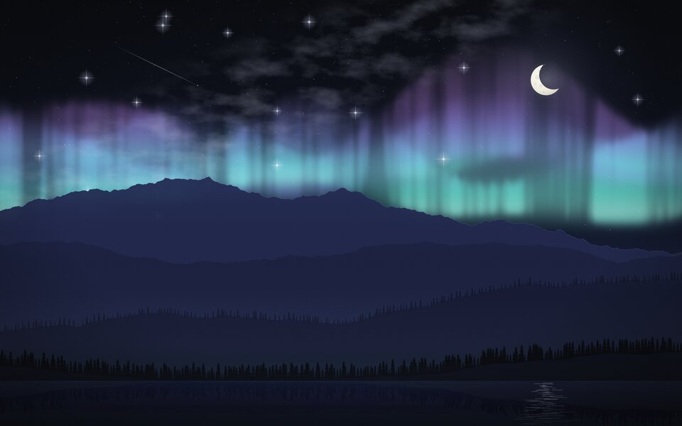

# T3 Code

## Nightfall theme

A dark theme for T3 Code with a periwinkle accent and a hand-drawn aurora night scene behind the chat. Light mode uses warm paper tones with an indigo accent and no image.



- `themes/nightfall.json`: colors, light variant and custom CSS (glass header and composer, styled markdown and tables, selected-thread pill).
- `themes/nightfall.webp`: the chat background, rendered from the SVG.
- `art/gen.py`: generates `art/nightfall.svg` (stars, aurora, moon, mountains, pines, lake reflection).
- `art/render.js`: renders an SVG to PNG with Playwright's Chromium.

### Install

```sh
mkdir -p ~/.t3/userdata/themes
cp t3code/themes/nightfall.json t3code/themes/nightfall.webp ~/.t3/userdata/themes/
```

Then pick **Nightfall** in T3 Code's appearance settings.

### Regenerate the art

```sh
python3 t3code/art/gen.py                                   # 2560x1600 -> /tmp/nightfall-art/nightfall.svg
python3 t3code/art/gen.py 3024 1964 /tmp/wall.svg           # any size, cropped from the bottom center
node t3code/art/render.js /tmp/nightfall-art/nightfall.svg /tmp/nightfall.png
node t3code/art/render.js /tmp/wall.svg /tmp/wall.png 3024 1964
cwebp -q 90 /tmp/nightfall.png -o ~/.t3/userdata/themes/nightfall.webp
```

`render.js` expects Playwright under `~/.local/share/playwright`.
